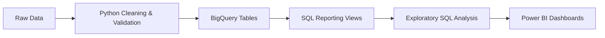

# Vitrina Marketplace Intelligence

### Sales Performance, Delivery Operations & Customer Experience


A data analytics portfolio project using **Python, SQL, Google BigQuery, and Power BI** to analyze the Brazilian Olist e-commerce marketplace dataset.

---

## Table of Contents

1. [Background and Overview](#1-background-and-overview)
2. [Data Structure Overview](#2-data-structure-overview)
3. [Executive Summary](#3-executive-summary)
4. [Insights Deep Dive](#4-insights-deep-dive)
5. [Recommendations](#5-recommendations)
6. [Conclusion](#conclusion)
7. [Project Limitations](#project-limitations)

---

## 1. Background and Overview

### Business Context

Vitrina is a fictional e-commerce marketplace used as the business context for this project. The analysis is based on publicly available Olist marketplace data covering historical transactions from 2016 to 2018.

The marketplace connects customers with multiple sellers across product categories such as Health & Beauty, Watches & Gifts, Bed, Bath & Table, Sports & Leisure, and Computers & Accessories.

As a marketplace grows, increasing revenue and order volume are only part of the picture. Delivery reliability, seller performance, customer satisfaction, regional demand, and repeat purchasing also influence long-term business performance.

### Problem Statement

> How can Vitrina use transactional data to understand its sales performance, identify operational weaknesses, and uncover opportunities to improve customer experience and marketplace growth?

This project investigates the relationship between sales, products, sellers, customer behaviour, delivery performance, and payment methods to support data-driven business decisions.

### Key Business Questions

| Area | Question |
|---|---|
| **Sales Performance** | How do revenue, order volume, and average order value change over time? |
| **Product Performance** | Which product categories and products contribute most to delivered revenue? |
| **Seller Performance** | Which sellers drive sales, and how concentrated is revenue across the seller base? |
| **Customer Experience** | How are delivery delays associated with customer satisfaction? |
| **Regional Performance** | Which customer states generate the most revenue, and where are delivery issues concentrated? |
| **Customer Retention** | How frequently do customers return, and how much revenue do repeat customers contribute? |
| **Payment Behaviour** | Which payment methods account for the largest share of recorded payment value? |

### Tools and Workflow

| Tool | Purpose |
|---|---|
| **Python (Pandas)** | Data cleaning, transformation, and validation |
| **SQL** | Exploratory data analysis and business metric calculation |
| **Google BigQuery** | Cloud data storage, reporting views, and SQL analysis |
| **Power BI** | Interactive dashboards, KPI tracking, and visual exploration |
| **Git and GitHub** | Version control and project documentation |



---

## 2. Data Structure Overview

### Dataset Overview

The project uses eight cleaned datasets from the Olist marketplace data model.

| Dataset | Description |
|---|---|
| `orders` | Order status, purchase timestamps, and delivery dates |
| `order_items` | Product, seller, item price, and freight charges |
| `order_payments` | Payment methods, recorded payment values, and installments |
| `order_reviews` | Customer review scores and written feedback |
| `customers` | Customer identifiers and geographic information |
| `products` | Product identifiers, categories, and physical attributes |
| `sellers` | Seller identifiers and geographic information |
| `category_translation` | Translation of product categories into English |

The cleaned CSVs are loaded into BigQuery for SQL analysis. Python validation checks support consistency in data types, keys, missing values, business rules, and relationships between datasets.

### BigQuery Reporting Views

Six reporting views were developed to provide reusable datasets for analysis and reporting.

| Reporting View | Grain | Purpose |
|---|---|---|
| `vw_order_reporting` | One row per order | Order KPIs, delivery performance, item and freight revenue, payments, and reviews |
| `vw_order_item_detail` | One row per order item | Product and seller performance, item-level revenue, and geographic filtering |
| `vw_order_category` | One row per delivered order-category pair | Category-level revenue and associated order-review metrics |
| `vw_payment_detail` | One row per payment record | Payment-method analysis |
| `vw_customer_summary` | One row per unique customer | Customer purchase frequency and revenue contribution |
| `vw_dim_category` | One row per normalized category | Shared category dimension for reporting |

The views preserve different levels of detail so that order-level, item-level, payment-level, and customer-level metrics can be analyzed without unintentionally multiplying records.

### Revenue Definition

```
Delivered Revenue = Item Revenue + Freight Revenue
```

Only orders marked as **delivered** are included in delivered revenue calculations.

This is a measure of recorded item prices and freight charges, **not** profit or net accounting revenue. Recorded payment value is analyzed separately because it does not necessarily reconcile perfectly with item and freight totals.

---

## 3. Executive Summary

### Key Performance Indicators

| KPI | Result |
|---|---|
| Total Orders | **99,441** |
| Delivered Orders | **96,478** |
| Customers with Delivered Orders | **93,358** |
| Total Delivered Revenue | **R$15.42M** |
| Average Order Value (Delivered Orders) | **R$159.83** |

### Headline Findings

**1. Strong historical revenue growth**
Between January–August 2017 and January–August 2018, delivered revenue increased by approximately **143.4%**, while delivered orders increased by approximately **139.9%**. Average order value rose by only about **1.4%**, indicating that higher order volume was the primary contributor to growth.

**2. Delivery performance is associated with customer satisfaction**
Among delivered orders with valid delivery dates, **6.77%** were late. Late orders had an average review score of **2.27/5**, compared with **4.29/5** for early deliveries.

**3. Revenue is geographically concentrated**
São Paulo contributed **37.42%** of delivered revenue. Together, São Paulo, Rio de Janeiro, and Minas Gerais accounted for approximately **62.55%**.

**4. A small share of customers made repeat purchases**
Approximately **97%** of customers with at least one delivered order had only one delivered order during the observed period. Repeat purchasing is therefore an opportunity for further investigation.

**5. Revenue is distributed across a broad seller base**
The marketplace had **2,970** sellers with delivered sales. The top seller accounted for **1.60%** of revenue, while **551** sellers collectively accounted for 80%.

### Executive Dashboard

<!-- PLACEHOLDER: Insert a screenshot of the Power BI Executive Summary / Marketplace Pulse page. -->

### Core KPI and Trend Results

<!-- PLACEHOLDER: Insert the output of 01_Core_Business_KPIs.sql. -->

<!-- PLACEHOLDER: Insert the output of 02_Monthly_Revenue_and_Order_Trends.sql. -->

---

## 4. Insights Deep Dive

### 4.1. Sales Performance and Growth

The January–August comparison highlights the scale of historical growth.

| Metric | Jan–Aug 2017 | Jan–Aug 2018 | Change |
|---|---:|---:|---:|
| Total Orders | 22,968 | 53,991 | +135.1% |
| Delivered Orders | 21,998 | 52,783 | +139.9% |
| Delivered Revenue | ~R$3.47M | R$8.45M | +143.4% |
| Average Order Value | R$157.87 | R$160.12 | +1.4% |

November 2017 was the strongest month in the historical monthly analysis, generating approximately **R$1.15M** in delivered revenue, an increase of about **53.6%** from October.

The results indicate that increased order volume, rather than a substantial increase in average order value, was the main contributor to observed growth.

> **Business implication:** Understanding the categories, sellers, and regions contributing to growth can help identify opportunities worth investigating further.

**SQL evidence** — `02_Monthly_Revenue_and_Order_Trends.sql`

<!-- PLACEHOLDER: Insert monthly revenue and order-growth output from 02_Monthly_Revenue_and_Order_Trends.sql. -->

### 4.2. Product Category and Product Performance

The five leading product categories contributed approximately **39.26%** of delivered revenue.

| Product Category | Delivered Revenue | Revenue Share |
|---|---:|---:|
| Health & Beauty | R$1.412M | 9.16% |
| Watches & Gifts | R$1.264M | 8.20% |
| Bed, Bath & Table | R$1.225M | 7.95% |
| Sports & Leisure | R$1.118M | 7.25% |
| Computers & Accessories | R$1.033M | 6.70% |

Health & Beauty was the largest category by delivered revenue. Its average review score was **4.23/5**, with an **11.42%** low-review share.

**Office Furniture** is a category worth investigating because it generated approximately **R$335,211** in delivered revenue while recording an average review score of **3.64/5** and a low-review share of **21.95%** across approximately 1,244 reviewed orders.

The product analysis also identifies the highest-revenue product IDs. Since the dataset does not provide actual product names, the results use product identifiers and category labels rather than invented product names.

> **Business implication:** Revenue contribution and customer feedback should be evaluated together to identify categories that perform well commercially and categories that warrant closer quality investigation.

**SQL evidence** — `03_Product_Category_Performance_and_Satisfaction.sql`, `04_Top_Products_by_Delivered_Revenue.sql`

<!-- PLACEHOLDER: Insert the output of 03_Product_Category_Performance_and_Satisfaction.sql. -->

<!-- PLACEHOLDER: Insert the output of 04_Top_Products_by_Delivered_Revenue.sql. -->

### 4.3. Seller Performance and Revenue Concentration

The seller analysis identified **2,970** sellers with delivered sales.

| Concentration Metric | Result |
|---|---:|
| Top Seller Revenue Share | 1.60% |
| Top 10 Sellers Revenue Share | 12.93% |
| Top 20 Sellers Revenue Share | 21.04% |
| Top 50 Sellers Revenue Share | 32.54% |
| Sellers Accounting for 80% of Revenue | 551 |

The marketplace's revenue is distributed across many sellers rather than being dominated by a single seller. However, a subset of sellers contributes a substantial share of total delivered revenue.

> **Business implication:** Seller performance management should consider sales contribution, order volume, geographic distribution, delivery outcomes, and customer feedback.

**SQL evidence** — `05_Seller_Performance.sql`, `06_Seller_Revenue_Concentration.sql`

<!-- PLACEHOLDER: Insert the output of 05_Seller_Performance.sql. -->

<!-- PLACEHOLDER: Insert the output of 06_Seller_Revenue_Concentration.sql. -->

### 4.4. Customer Repeat Purchasing

Among the **93,358** customers with at least one delivered order, approximately **97%** placed only one delivered order during the observation window.

| Customer Segment | Customers | Customer Share |
|---|---:|---:|
| One Delivered Order | 90,557 | 97.0% |
| Exactly Two Delivered Orders | 2,573 | 2.8% |
| Three or More Delivered Orders | 228 | 0.2% |

The 2,801 customers with multiple delivered orders contributed approximately **5.61%** of delivered revenue.

> **Business implication:** Customer retention deserves further investigation. The observed repeat-purchase rate is not definitive evidence of long-term retention because the dataset covers a finite historical period.

**SQL evidence** — `07_Customer_Repeat_Purchase_and_Revenue_Contribution.sql`

<!-- PLACEHOLDER: Insert the output of 07_Customer_Repeat_Purchase_and_Revenue_Contribution.sql. -->

### 4.5. Payment Method Distribution

| Payment Method | Share of Recorded Payment Value |
|---|---:|
| Credit card | 78.46% |
| Boleto | 17.96% |
| Voucher | 2.22% |
| Debit card | 1.35% |

The payment results describe recorded transaction values and payment-method distribution. They do not measure checkout abandonment or failed payment attempts.

> **Business implication:** Credit-card and boleto flows deserve particular attention in payment reporting because they account for most recorded payment value.

**SQL evidence** — `08_Payment_Method_Distribution.sql`

<!-- PLACEHOLDER: Insert the output of 08_Payment_Method_Distribution.sql. -->

### 4.6. Delivery Performance and Customer Satisfaction

Among **96,476** delivered orders with both actual and estimated delivery dates, **91.89%** arrived early, **6.77%** arrived late, and **1.34%** arrived exactly on the estimated date.

| Delivery Outcome | Average Review Score | Low-Review Share (Score ≤ 2) |
|---|---:|---:|
| Early | 4.29 / 5 | 9.19% |
| On Estimated Date Exactly | 4.04 / 5 | 12.27% |
| Late | 2.27 / 5 | 62.36% |

Customer satisfaction deteriorated further as delay duration increased.

| Delivery Timing | Average Review Score | Low-Review Share |
|---|---:|---:|
| 1–3 Days Late | 3.29 | 32.18% |
| 4–7 Days Late | 2.11 | 67.56% |
| 8+ Days Late | 1.70 | 79.18% |

> **Business implication:** Longer delivery delays are strongly associated with worse customer feedback. The relationship provides a clear operational area to investigate, although the analysis does not establish causation.

**SQL evidence** — `09_Delivery_Performance_and_Customer_Satisfaction.sql`, `10_Delivery_Delay_and_Satisfaction_Correlation.sql`

<!-- PLACEHOLDER: Insert the output of 09_Delivery_Performance_and_Customer_Satisfaction.sql. -->

<!-- PLACEHOLDER: Insert the output of 10_Delivery_Delay_and_Satisfaction_Correlation.sql. -->

### 4.7. Regional Demand and Delivery Performance

Three customer states generated approximately **62.55%** of delivered revenue.

| Customer State | Delivered Revenue | Revenue Share |
|---|---:|---:|
| São Paulo | R$5.77M | 37.42% |
| Rio de Janeiro | R$2.055M | 13.33% |
| Minas Gerais | R$1.819M | 11.80% |

Delivery outcomes vary substantially by region. São Paulo had the largest number of late deliveries, while Rio de Janeiro and Bahia recorded late-delivery rates above 12%.

Smaller-volume states, such as Alagoas, also showed high late-delivery rates, but their results require cautious interpretation because relatively few orders can produce volatile percentages.

> **Business implication:** Operational priorities should consider both the volume of late orders and the late-delivery rate. These measures distinguish the regions where the most customers are affected from those where late delivery is disproportionately common.

**SQL evidence** — `11_RegionalDemand_DeliveryPerformance_CustomerSatisfaction.sql`, `12_Delivery_delay_Severity.sql`

<!-- PLACEHOLDER: Insert the output of 11_RegionalDemand_DeliveryPerformance_CustomerSatisfaction.sql. -->

<!-- PLACEHOLDER: Insert the output of 12_Delivery_delay_Severity.sql. -->

---

## 5. Recommendations

### 5.1. Improve Delivery Reliability

Delivery delays have the clearest observed association with customer dissatisfaction.

- Investigate delays exceeding four days, where low-review shares increase substantially.
- Prioritize São Paulo for reducing the largest absolute number of late orders.
- Investigate high late-delivery rates in Rio de Janeiro and Bahia.
- Review delivery estimates and communicate proactively with customers when delays are expected.
- Monitor whether improvements in delivery reliability coincide with better customer feedback.

**Suggested KPIs:** Late-delivery rate, average days late, 90th-percentile delay, average review score, and low-review share.

### 5.2. Focus on Category-Level Customer Experience

Use category revenue and customer feedback together to determine where to protect performance and where to investigate possible quality issues.

- Investigate Office Furniture at the product and seller levels.
- Identify recurring issues among products associated with low review scores.
- Monitor leading categories for deterioration in review outcomes.
- Evaluate review counts alongside average ratings and low-review shares to avoid overreacting to small samples.

**Suggested KPIs:** Delivered revenue, revenue share, items sold, average review score, and low-review share.

### 5.3. Develop Customer Retention Strategies

The low observed repeat-purchase rate suggests that customer retention merits further investigation.

- Build cohort-based repeat-purchase measurements using customers' first delivered orders.
- Explore post-delivery follow-ups and relevant cross-sell or replenishment initiatives.
- Test retention interventions against a comparison group where feasible.
- Evaluate whether repeat purchases increase without harming customer satisfaction or revenue per order.

**Suggested KPIs:** Repeat-purchase rate, time to second delivered order, repeat-customer revenue share, and revenue per delivered order.

### 5.4. Strengthen Seller Performance Management

Use consistent performance measures across the seller base, with additional attention to sellers that contribute substantial revenue.

- Create seller scorecards combining revenue, delivered orders, product breadth, and customer experience.
- Investigate high-contribution sellers with weaker delivery or review outcomes.
- Maintain performance standards for the broader seller base rather than focusing exclusively on the largest sellers.
- Establish a careful attribution method before assigning an order-level delay or review to an individual seller.

**Suggested KPIs:** Seller delivered revenue, revenue share, delivered order count, late-delivery rate, and review outcomes.

### 5.5. Manage Regional Performance Using Both Demand and Risk

Regional investment decisions should account for sales contribution and delivery reliability.

- Protect service quality in high-revenue states.
- Investigate regions with high late-delivery rates even when their revenue contribution is smaller.
- Apply minimum sample-size thresholds when comparing smaller regions.
- Distinguish customer-state demand from seller-state and seller-city geography.

**Suggested KPIs:** Delivered revenue by state, revenue share, late-order count, late-delivery rate, and customer satisfaction.

### 5.6. Support Growth With Balanced Monitoring

Historical revenue growth was primarily volume-driven.

- Monitor order volume and delivered revenue together.
- Track AOV, cancellations, delivery reliability, and customer satisfaction alongside growth.
- Investigate the categories, regions, and sellers contributing to major monthly peaks.
- Use consistent reporting periods when comparing years, particularly because later months of 2018 are sparse or incomplete.

**Suggested KPIs:** Monthly delivered revenue, delivered orders, AOV, cancellation rate, late-delivery rate, and revenue by category and region.

---

## Conclusion

This project combines data cleaning and validation, SQL-based business analysis, reusable BigQuery reporting views, and interactive Power BI reporting to examine marketplace performance across sales, products, sellers, customers, payments, and delivery operations.

The findings identify several practical areas for further investigation: improving delivery reliability, monitoring category-level customer experience, developing repeat purchasing, and strengthening seller-performance management.

All findings reflect historical Olist data from 2016–2018. Vitrina is a fictional business case, and the observed relationships indicate areas for investigation rather than proven causal effects.

---

## Project Limitations

- Delivered revenue represents recorded item prices plus freight charges, not profit or net accounting revenue.
- Recorded payment value is analyzed separately from delivered revenue.
- Customer-review scores are aggregated at the order level. When associated with product categories, they represent category-associated order satisfaction, not individual product ratings.
- The finite observation period limits conclusions about long-term customer retention.
- The analysis is observational and does not independently establish the causes of delivery delays, sales growth, or customer dissatisfaction.
