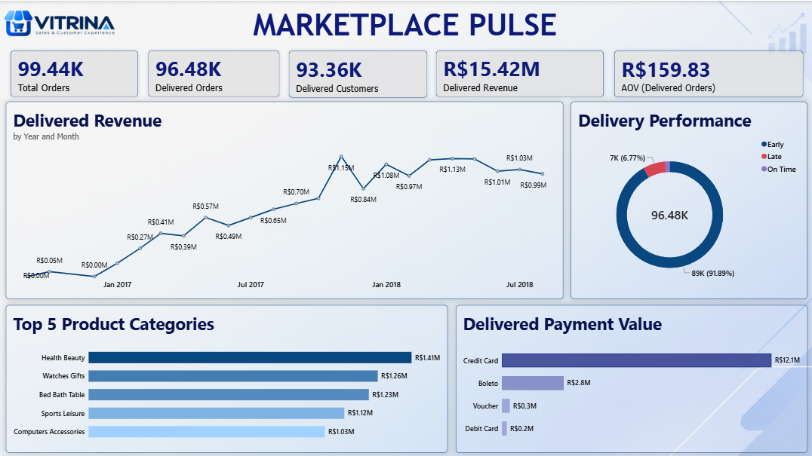
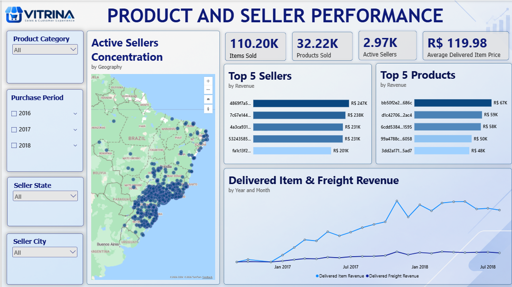
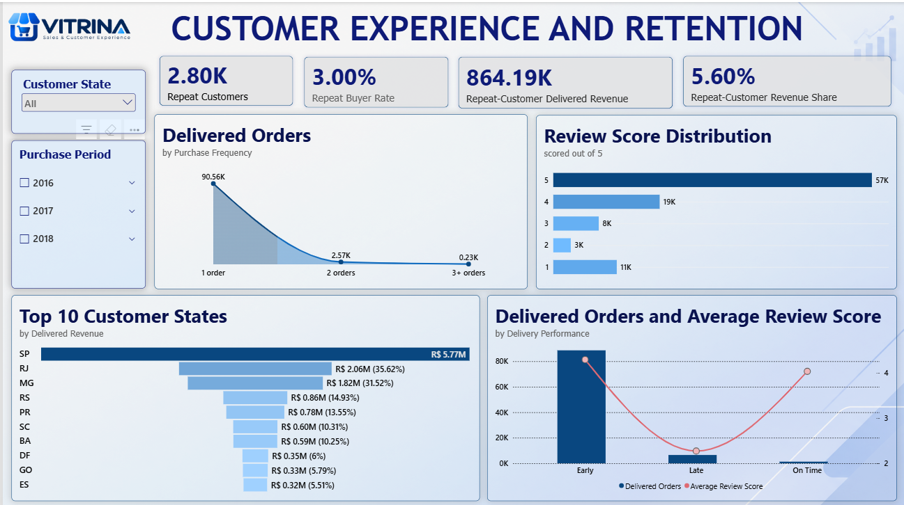
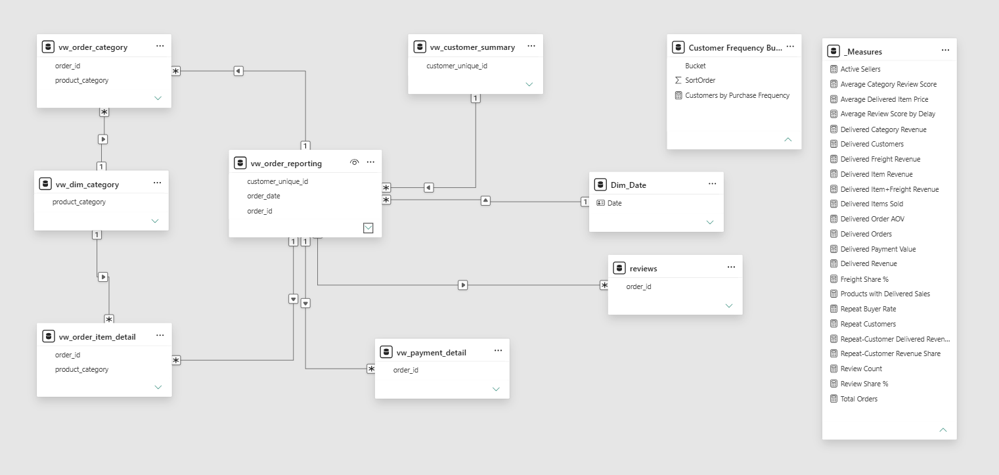

# Vitrina Marketplace Intelligence
## 1. Project Context

### About Vitrina

**Vitrina** is an online marketplace that connects independent sellers across Brazil with customers nationwide and tracks each order from purchase through payment, delivery and customer review. Its focus is *Sales & Customer Experience*.

> **Note:** Vitrina is a **sample company created for this analysis**. Its trading history is represented by the anonymised *Brazilian E-Commerce Public Dataset by Olist*, so the figures in this report describe that dataset, not a real Vitrina business.

### Business situation

After a year of rapid growth in 2017, Vitrina's leadership team wants to know whether the marketplace is healthy and where to focus next. The analytics team was asked to review performance across sales, sellers, delivery and customers, and to turn the findings into clear priorities. This report and its interactive dashboard are the result.

### Objectives

The review answers four questions:

| # | Area | Question |
|---|------|----------|
| 1 | **Sales** | How has revenue grown, and which categories and payment methods drive it? |
| 2 | **Products & Sellers** | Which sellers and products perform best, and how concentrated is the seller base? |
| 3 | **Delivery** | How reliable is delivery against the promised date, and how does it affect customer satisfaction? |
| 4 | **Customers** | How loyal are customers, and how much revenue do repeat buyers contribute? |

---


## Contents

1. [Project Context](#1-project-context)
2. [Executive Summary](#2-executive-summary)
3. [Key Findings](#3-key-findings)
4. [Recommendations](#4-recommendations)
5. [Using the Dashboard](#5-using-the-dashboard)
6. [Data & Methodology](#6-data--methodology)
7. [Planned Enhancements](#7-planned-enhancements)
8. [Appendix: Technical Architecture](#appendix-technical-architecture)

---

## 2. Executive Summary

Between September 2016 and August 2018 Vitrina received **99.44K orders**, of which **96.48K (97%) were delivered**, generating **R$15.42M** in delivered revenue at an average order value of **R$159.83**.

Revenue grew quickly through 2017, peaked at **R$1.15M in November 2017**, and has since held near **R$1.0M a month**. The business is larger than a year ago, but month-on-month growth has levelled off.

| Orders | Delivered revenue | Avg. order value | Active sellers | Late deliveries | Repeat buyer rate |
|:---:|:---:|:---:|:---:|:---:|:---:|
| **99.44K** | **R$15.42M** | **R$159.83** | **2.97K** | **6.77%** | **3.00%** |

**What is working**
- Delivery is largely dependable: **91.89%** of delivered orders arrive before the estimated date.
- Revenue is not dependent on a few categories or sellers. The largest category is about 9% of revenue, and the top 5 sellers together are under 10%.

**What needs attention**
1. **Retention.** About 97% of customers buy only once.
2. **Late deliveries.** Only 6.77% of orders are late, but those orders average roughly 2 out of 5 in review score, against roughly 4 out of 5 for everything else.
3. **Geographic concentration.** São Paulo, Rio de Janeiro and Minas Gerais account for about 63% of delivered revenue.

The prioritised actions are in [Section 4](#4-recommendations).

---

## 3. Key Findings

### 3.1 Revenue growth and sales mix



- **Growth has levelled off.** Monthly delivered revenue rose from under R$0.1M in late 2016 to a R$1.15M peak in November 2017, then held at roughly R$1.0M a month through August 2018.
- **Volumes are still above last year.** In January to August 2018 the marketplace sold **60.32K items**, more than the **49.56K** sold across all of 2017.
- **The category mix is balanced.** The top five categories together make up about 39% of revenue.

  | Category | Delivered revenue |
  |----------|------------------:|
  | Health & Beauty | R$1.41M |
  | Watches & Gifts | R$1.26M |
  | Bed, Bath & Table | R$1.23M |
  | Sports & Leisure | R$1.12M |
  | Computers & Accessories | R$1.03M |

- **Payments rely on two methods.** Credit card is about 79% of payment value (R$12.1M) and boleto about 18% (R$2.8M). Vouchers (R$0.3M) and debit cards (R$0.2M) are marginal.

### 3.2 Products and sellers



- **A large and growing seller base.** 2.97K active sellers sold 110.20K items across 32.22K products, at an average item price of R$119.98. Active sellers grew from 129 in 2016 to 1.69K in 2017 and 2.33K in 2018 (January to August).
- **Low dependence on individual sellers.** The top five sellers each earn R$201K to R$247K, and together account for under 10% of revenue.
- **Sellers cluster in the south-east and south.** The map shows dense activity around São Paulo and far fewer sellers in the north and interior.
- **Freight is a small share of revenue.** Item revenue is well above freight revenue throughout the period.

### 3.3 Delivery performance



*The Customer Experience & Retention page covers both this section and 3.4.*

- **Most orders arrive early.** 91.89% of delivered orders arrived before the estimated date, about 1.3% on the date, and 6.77% (about 7K orders) late.
- **Late delivery is the main driver of poor reviews.** Late orders average roughly **2 / 5**, against roughly **4 / 5** for early and on-time orders.
- **Satisfaction is high overall but polarised.** About 58% of reviews are 5 stars, but about 11% are 1 star, more than the 2-star and 3-star scores individually.
- **Estimates look conservative.** With so few orders arriving exactly on time, the promised dates appear to carry a large buffer.

### 3.4 Customers and retention

- **Very few customers return.** Of 93.36K delivered customers, only 2.80K (3.00%) placed two or more orders.
- **Repeat customers are worth more.** They generate R$864.19K, or **5.6%** of delivered revenue, about 1.9 times their share of the customer base.
- **Revenue is concentrated in three states.** São Paulo contributes R$5.77M (about 37% of delivered revenue), followed by Rio de Janeiro (R$2.06M) and Minas Gerais (R$1.82M). Together they make up about 63%.

> Figures marked "about" or "roughly" were calculated from dashboard values or read from chart labels.

---

## 4. Recommendations

| Priority | Recommendation | Supporting evidence | Success measure |
|:---:|----------------|---------------------|-----------------|
| **High** | **Launch a retention programme.** Test post-purchase follow-ups and loyalty offers aimed at the second order. | About 97% of customers buy once; repeat customers earn about 1.9× their share of the base | Repeat buyer rate; repeat-customer revenue share |
| **High** | **Cut late deliveries in the weakest regions and seller groups.** Use the dashboard's state and seller filters to find them. | 6.77% late orders, with review scores near 2 / 5 | Late delivery %; average review score by delivery performance |
| **High** | **Re-accelerate growth.** Review acquisition and conversion activity, since monthly revenue has held near R$1.0M since Nov 2017. | Plateau after the Nov 2017 peak, despite higher item volumes in 2018 | Monthly delivered revenue; delivered orders |
| **Medium** | **Reduce regional concentration.** Recruit sellers and build logistics capacity outside the south-east. | About 63% of revenue from SP, RJ and MG; sellers cluster in the south-east | Revenue share outside the top three states; active sellers by state |
| **Medium** | **Review delivery estimates.** Tighten promised dates gradually and monitor reviews. | 91.89% of orders arrive early; about 1.3% on the date | Early, on-time and late share; average review score |
| **Medium** | **Protect payment reliability.** Prioritise checkout stability for credit card and boleto. | About 79% and 18% of payment value | Payment value by method |

---

## 5. Using the Dashboard

The interactive Power BI report has three pages. Slicers filter every visual on a page.

| Page | Answers | Slicers |
|------|---------|---------|
| **Marketplace Pulse** | How large is the business, how is it trending, and how are orders delivered and paid for? | n/a |
| **Product & Seller Performance** | Which sellers, products and categories lead, and where are sellers located? | Product category, purchase period, seller state, seller city |
| **Customer Experience & Retention** | How loyal and satisfied are customers, and how does delivery affect reviews? | Customer state, purchase period |

---

## 6. Data & Methodology

**Source.** The *Brazilian E-Commerce Public Dataset by Olist* (Kaggle): anonymised order, item, payment, review, customer, seller and product data for 2016 to 2018. Vitrina is a sample company, and this dataset stands in for its trading history.

**Approach.** Revenue, customer and delivery KPIs are calculated on **delivered orders only**, so cancelled or unfulfilled orders do not inflate results. Customers are counted by `customer_unique_id`, because the source assigns a new `customer_id` to every order.

### Metric definitions

| Metric | Definition |
|--------|------------|
| **Delivered Orders** | Orders with status *delivered* |
| **Delivered Customers** | Unique customers with at least one delivered order |
| **Delivered Revenue** | Revenue from delivered orders |
| **AOV (Delivered Orders)** | Delivered revenue ÷ delivered orders |
| **Average Delivered Item Price** | Average item price across delivered items |
| **Active Sellers** | Sellers with delivered sales in the selected period |
| **Delivery Performance** | Delivered date compared with the estimated delivery date: *Early*, *On Time*, *Late* |
| **Repeat Customers** | Customers with 2 or more delivered orders |
| **Repeat Buyer Rate** | Repeat customers ÷ delivered customers |
| **Repeat-Customer Revenue Share** | Delivered revenue from repeat customers ÷ total delivered revenue |
| **Freight Share %** | Freight revenue as a share of delivered revenue |

### Limitations

- **Historical data.** Findings describe 2016 to 2018, not current performance.
- **Sparse 2016.** Only a few hundred orders exist for 2016, so its percentages are not reliable.
- **No cost or margin data.** The analysis covers revenue, not profitability.
- **Repeat behaviour.** Repeat metrics reflect this dataset's observation window; many customers appear only once.
- **Review text not analysed.** Only review scores and a written-feedback flag are used.
- **Association, not causation.** Links such as late delivery and low review scores are observed relationships.

---

## 7. Planned Enhancements

- Year-to-date, month-on-month and year-on-year comparison measures
- Cohort and RFM analysis for customer segmentation
- Sentiment analysis of Portuguese review comments
- Revenue forecasting for the next quarter

---

## Appendix: Technical Architecture

**Pipeline**

```
Raw CSV files → Python (Pandas) → BigQuery tables → SQL reporting views → Power BI model → Dashboard
```

| Stage | Tool | Purpose |
|-------|------|---------|
| Data preparation | Python (Pandas) | Loading, profiling and cleaning the raw files |
| Data warehouse | SQL on Google BigQuery | Reporting views (`vw_*`) at order, order-item, payment, customer and category grain |
| Data model | Power BI + DAX | Relationships, a dedicated `_Measures` table and delivered-only logic |
| Reporting | Power BI | Three-page interactive dashboard |

**Data model**



| Table | Grain (one row per…) | Role |
|-------|----------------------|------|
| `vw_order_reporting` | order | Central reporting table (dates, status, delivery performance, order totals) |
| `vw_order_item_detail` | order item | Product, seller, price and freight detail |
| `vw_payment_detail` | order payment | Payment type, installments and value |
| `reviews` | review | Review score and written-feedback flag |
| `vw_customer_summary` | unique customer | Purchase frequency and customer-level revenue |
| `vw_order_category` | order × category | Pre-aggregated category revenue and review score |
| `vw_dim_category` | category | Shared category dimension |
| `Dim_Date` | date | Calendar dimension (year, quarter, month) |
| `Customer Frequency Bucket` | bucket | Disconnected table for ordered buckets (1, 2, 3+ orders) |
| `_Measures` | n/a | All DAX measures |

All relationships are one-to-many with single-direction filtering. Planned model enhancements: dedicated seller and customer dimensions.

**Repository contents**

```
.
├── README.md
├── 01_Pre_EDA_DataValidation.ipynb   # Python data validation notebook
├── OList_EDA_SQL_Queries/            # Exploratory SQL queries (BigQuery)
├── OList_EDA_SQL_TableViews/         # Reporting view definitions (vw_*)
├── OList_Sales_Analytics.pbix        # Power BI report
├── Report_Screenshots/               # Dashboard and data model screenshots
└── LICENSE
```

---
